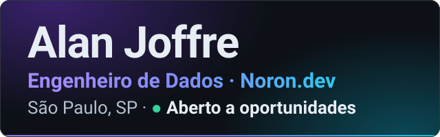

  
  
  
  

Construo produtos de dados de ponta a ponta, do lakehouse (Databricks, Delta Lake e dbt) à IA aplicada com avaliação (RAG, fine-tuning e Text-to-SQL). Alocado em cliente de mobilidade e pagamentos, desenhei um lakehouse em Databricks e dbt que reduziu o tempo de apuração de até 20 para 2 dias. Hoje respondo pelo desenvolvimento e pela operação da Aira, produto de IA da [Noron.dev](https://noron.dev).

## Em produção

**Aira**, produto de IA da Noron.dev, em produção na AWS desde maio/2026, em instância dedicada por cliente. Respondo pelo desenvolvimento e pela operação. Código fechado: os números abaixo vêm do repositório privado e da operação, e não podem ser conferidos num repositório público.

- **Problema:** cada pessoa da empresa precisa perguntar, em português, sobre os arquivos da própria empresa e receber a resposta com a fonte, sem acesso ao que não tem permissão de ver.
- **Decisão:** conduzi o desenho da IA com ferramentas só de leitura (recuperação agêntica), confinada às pastas que cada pessoa tem permissão de ver, com os arquivos consultados listados como fonte; e a avaliação das respostas antes de mudar prompt, modelo ou esforço.
- **Resultado:** mais de 30 casos de avaliação em 7 categorias (dados fictícios, conferência determinística); fila, limite por minuto, cota mensal e teto de gasto no uso da IA; mais de 5.000 testes automatizados de back-end; trilha de auditoria encadeada por hash, que detecta adulteração; backup diário com cópia externa cifrada; mais de 60 versões publicadas.
- **Stack:** Python/FastAPI · SvelteKit · PostgreSQL · Docker · AWS

## Projetos open source

Nos projetos abaixo, cada número vem de um teste ou de uma medição que roda no repositório. Os projetos abertos são feitos com apoio de assistente de IA; o escopo, as decisões de arquitetura e as medições são meus, e revisei o resultado.

- **[oss-lakehouse](https://github.com/alanjoffre/oss-lakehouse)** — lakehouse sobre dados reais do GitHub. 18 notebooks executados e mais de 180 testes, com CI. [Guia de estudo](https://github.com/alanjoffre/oss-lakehouse/blob/main/GUIA_DE_ESTUDO.md) com 199 perguntas respondidas.
- **[toll-analytics-platform](https://github.com/alanjoffre/toll-analytics-platform)** — plataforma de dados de ponta a ponta com dlt, dbt, Airflow e Soda, construída do zero com dados sintéticos; executada em DuckDB e desenhada para Databricks (Terraform validado, sem `apply`); CI/CD com 10 workflows. [Dashboard ao vivo](https://alanjoffre.github.io/toll-analytics-platform/)
- **[RodoIA](https://github.com/alanjoffre/rodoia)** — engenharia de IA de ponta a ponta, sobre dados públicos da ANTT. Fine-tuning com F1 de 0,13 para 0,77; avaliação como gate de CI (gate 30/30). [Demo ao vivo](https://huggingface.co/spaces/alanjoffre/rodoia-rag)
- **[RodoQuery](https://github.com/alanjoffre/rodoquery)** — Text-to-SQL sobre camada semântica: 100% contra 44,5% do SQL direto (n=146, dados reais da ANTT; o 100% é teto do instrumento).
- **[NãoConsta](https://github.com/alanjoffre/naoconsta)** — RAG contratual avaliado pelo que recusa responder: 510 contratos e 20.910 perguntas.
- **[Ledgerly Bank](https://github.com/alanjoffre/ledgerly-bank)** — banco digital fictício em Java, com Pix em Saga e Outbox. 1.141 testes e 96,7% de mutação no domínio.

Todos os estudos de caso, com as decisões e os números, estão no **[portfólio](https://github.com/alanjoffre/portfolio)**.

## Stack

**Dados:** `Python` `SQL` `Apache Spark (PySpark)` `Databricks` `Delta Lake` `dbt` `dlt` `Airflow` `Kafka` `DuckDB` `PostgreSQL` `ETL/ELT` 
**Qualidade e governança de dados:** `testes dbt` `Soda` `OpenLineage` `Unity Catalog` 
**IA e MLOps:** `LLMs (APIs de modelos de linguagem)` `avaliação de LLMs (evals)` `RAG` `LangGraph` `Qdrant` `QLoRA` `vLLM` `PyTorch` `Hugging Face` `MLflow` `DVC` 
**Cloud e DevOps:** `AWS` `Azure` `Docker` `Terraform` `GitHub Actions` 
**Back-end e front-end:** `FastAPI` `Java (Spring Boot e Quarkus)` `SvelteKit` `TypeScript`

## Contato

[LinkedIn](https://www.linkedin.com/in/alanjoffre) · [Página pessoal](https://alanjoffre.github.io/my-profile/) · [Currículo (PDF)](https://alanjoffre.github.io/my-profile/assets/curriculo_alanjoffre_ptbr.pdf) · [E-mail](mailto:alanjoffre01@gmail.com)
